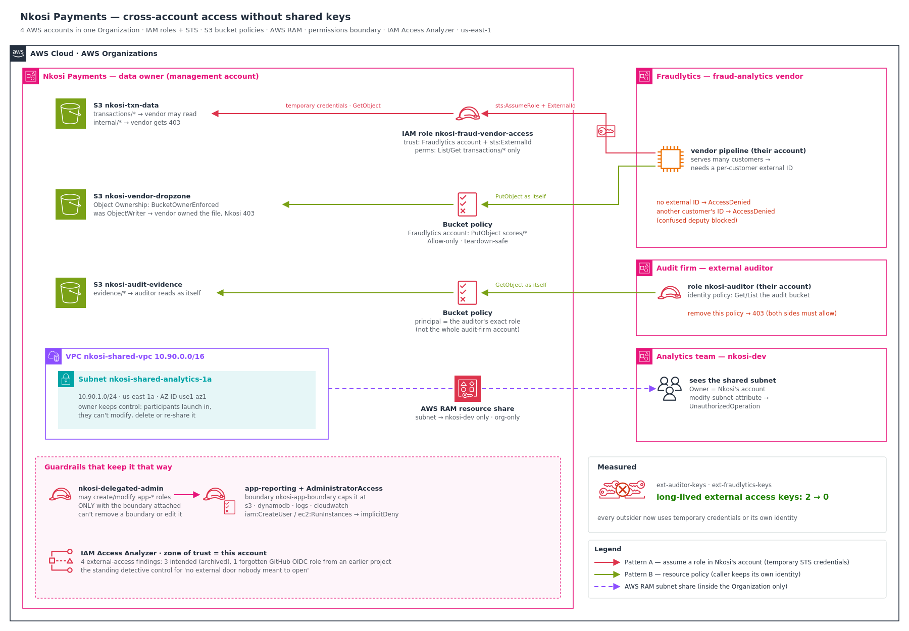

# Cross-Account Access Without Shared Keys: roles, resource policies and guardrails across four AWS accounts

Nkosi Payments shares data with two outsiders. An **external audit firm** needs to read audit evidence, and a **fraud-analytics vendor** needs to read transaction data and write fraud scores back. Until now, both got the same thing: an IAM user created in Nkosi's account, with an access key emailed across. Those keys never expired, nobody could say where they were stored, and if the vendor was breached, Nkosi was breached with it.

I replaced every shared key with the cross-account pattern that fits each job, across **four real AWS accounts in one Organization**. Then I proved each pattern works, and tried to break each one to show the guardrails hold.

**Headline results:**

- **Long-lived external access keys: 2 → 0.** Every outsider now uses temporary credentials or its own identity.
- The vendor **assumes a role** with an **external ID**. It reads `transactions/*` and gets `403` on `internal/*`. Without the external ID, or with another customer's, it gets `AccessDenied`.
- The auditor reads evidence **as itself** through a **bucket policy**. When I removed the auditor's own identity policy, access failed even though Nkosi's bucket policy still allowed it: **cross-account, both sides must say yes.**
- I reproduced the classic S3 ownership trap: the vendor wrote a file into Nkosi's bucket, and **Nkosi got `403` on its own bucket**. One setting (`BucketOwnerEnforced`) fixed it, and ownership moved to Nkosi.
- A **permissions boundary** let a delegated admin attach `AdministratorAccess` to a role, and the policy simulator showed that role still **couldn't create an IAM user or launch an EC2 instance**.
- **IAM Access Analyzer** flagged the three doors I opened on purpose, and **one I'd forgotten**: a GitHub OIDC deploy role left over from an earlier project.
- Total cost: **`$0.00`**.



---

## The problem I was solving

In `aws-iam-least-privilege` I stopped Zenzele Health's staff sharing credentials internally. Nkosi Payments had the same problem at its borders. Two IAM users existed only so outsiders could hold a key:

- `ext-auditor-keys`: its access key was emailed to the audit firm.
- `ext-fraudlytics-keys`: its access key sat in the vendor's pipeline config.

Those keys were:

- **Long-lived.** They worked until someone remembered to delete them.
- **Unscoped in time.** The auditor needs access for about three weeks a year. The key worked all year.
- **Unattributable.** CloudTrail recorded that `ext-auditor-keys` did something, but not *which person at the audit firm* did it.
- **A third-party breach liability.** If Fraudlytics leaked its config, the key opened Nkosi's data.

> **Requirement:** remove every long-lived external access key. Give each outsider the narrowest cross-account pattern that fits its job. Prove each one works, prove the guardrails (external ID, the both-sides rule, object ownership) block misuse, and leave a detective control that surfaces any external access nobody intended.

For a payments company this isn't housekeeping. Shared credentials held by third parties are exactly what PCI DSS and POPIA's operator rules exist to stop (see [Compliance & frameworks](#compliance--frameworks)).

---

## Four ideas the whole build depends on

1. **Cross-account access needs both sides to say yes.** Inside one account, an identity policy *or* a resource policy is enough. Across accounts, the resource owner's policy (a bucket policy or a role's trust policy) **and** the caller's own identity policy must both allow the action. I proved this by deleting one side and watching access fail.
2. **Letting an outsider in can mean two different things.**
   - **Role assumption:** the outsider *becomes* a role in your account and works with temporary credentials. While it holds that role, it has only that role's permissions.
   - **Resource-based policy:** the outsider stays itself, and your resource lets it in directly. This only works for services that support resource policies (S3, KMS, SQS, SNS, Lambda, Secrets Manager and others).
3. **An external ID stops the confused deputy.** Fraudlytics serves many customers, and every one of them trusts Fraudlytics' account. Without a per-customer external ID, one customer could configure Fraudlytics' system with *Nkosi's* role ARN and have Fraudlytics read Nkosi's data for them. The external ID is a value only Nkosi and Fraudlytics agree on, and the trust policy requires it.
4. **Whoever writes an object isn't always its owner.** With S3 ACLs enabled, an object a vendor writes into *your* bucket belongs to the vendor. **Bucket owner enforced** (ACLs disabled) makes the bucket owner own everything.

---

## Architecture decisions

| Requirement | Decision | Why |
|---|---|---|
| The vendor's pipeline reads transaction data | **Cross-account IAM role with an external ID** | Temporary credentials scoped to one prefix. Revocable by editing one trust policy. The external ID blocks confused-deputy misuse |
| The auditor reads evidence and stays attributable | **Bucket policy naming the auditor's exact role** | The auditor keeps its own identity, so CloudTrail shows exactly which audit-firm principal acted |
| The vendor writes results back into Nkosi's bucket | **Bucket policy for `PutObject` + Object Ownership `BucketOwnerEnforced`** | Nkosi must own everything in its own bucket, whoever wrote it |
| The internal analytics team runs workloads in the central network without owning it | **AWS RAM subnet sharing**, Organization only | One centrally governed VPC. Participants launch into it and can't change it. No peering mesh |
| App teams create IAM roles without holding admin | **Permissions boundary**, enforced on a delegated-admin role | They can create roles, but no role they create can exceed the boundary |
| Know about any external access nobody intended | **IAM Access Analyzer**, zone of trust = the account | A continuous detective control: every external path is a finding |
| Prove it | Assume with and without the external ID, remove one side of the both-sides rule, ownership before and after, participant edit, boundary escape attempts, analyzer findings, key count | Evidence, not assurances |

Long-form reasoning is in [`docs/adr/`](docs/adr). The architecture diagram uses the **official AWS Architecture Icons** and is generated from [`docs/diagram/build_architecture.py`](docs/diagram/build_architecture.py), so it can be rebuilt rather than hand-edited. The icon pack itself isn't committed: AWS licenses it for diagrams, not redistribution. Point `AWS_ICONS_DIR` at your own download to regenerate.

---

## Pattern A vs Pattern B: what actually differs

Choosing the wrong pattern is the common mistake. The difference isn't which is "more secure". It's **whose identity performs the action** and **what the caller keeps**.

| | Role assumption (fraud vendor) | Resource-based policy (auditor) |
|---|---|---|
| Whose identity acts | **Nkosi's role**: `assumed-role/nkosi-fraud-vendor-access/fraudlytics-pipeline` in Nkosi's account | **The auditor's own role**: `assumed-role/nkosi-auditor/...` in the audit firm's account |
| Does the caller keep its own permissions? | No. It has only the assumed role's permissions | Yes. It's still itself |
| Credentials | Temporary STS credentials (my session expired after one hour) | The caller's own |
| Revoke by | Editing one trust policy in Nkosi's account | Editing the bucket policy |
| Works for | Anything IAM can grant | Only services with resource policies |
| Confused-deputy defence | **External ID** | Naming the exact principal ARN |
| Best when | A vendor's automated system acts *on your behalf* | A party must remain *attributable as itself* |

More detail, including why objects the vendor writes behave differently depending on which pattern it uses, is in [`docs/cross-account-patterns.md`](docs/cross-account-patterns.md).

---

## What I proved

| Test | Result | Evidence |
|---|---|---|
| One terminal, four accounts: CLI profiles chained through `OrganizationAccountAccessRole` | ✅ An identity in each member account | [`01`](docs/screenshots/01-step0-profiles-verified.png) |
| Baseline: long-lived external keys | **2** | [`02`](docs/screenshots/02-step1-baseline-two-external-keys.png) |
| Private buckets with realistic data: `transactions/`, `internal/`, `evidence/` | ✅ Block Public Access on. Cross-account is not public | [`03`](docs/screenshots/03-step2-buckets-and-seed-data.png) |
| Vendor assumes the role **with** the external ID | ✅ Temporary credentials (1-hour expiry). Identity is `assumed-role/nkosi-fraud-vendor-access/fraudlytics-pipeline`. CSV read works, `internal/contracts.txt` → **403** | [`04`](docs/screenshots/04-step3-vendor-role-external-id-trust.png), [`05`](docs/screenshots/05-step3-vendor-assumed-role-prefix-scoped.png) |
| **Trap A:** no external ID, then another customer's ID | ✅ Both **`AccessDenied`** on `sts:AssumeRole`, from an admin in the right account | [`06`](docs/screenshots/06-trapA-external-id-missing-and-wrong-denied.png) |
| Auditor reads evidence as itself | ✅ Identity is in the audit firm's account. List and read work | [`07`](docs/screenshots/07-step4-auditor-own-identity.png), [`08`](docs/screenshots/08-step4-auditor-reads-evidence.png) |
| **Trap B:** delete the auditor's identity policy, keep Nkosi's bucket policy | ✅ **403**. Restored → works again | [`09`](docs/screenshots/09-trapB-identity-policy-removed-denied-then-restored.png) |
| **Trap C:** vendor writes into an `ObjectWriter` bucket | ✅ Nkosi gets **403** on its own bucket. The object's owner is the vendor's canonical ID | [`10`](docs/screenshots/10-trapC-dropzone-objectwriter.png)–[`12`](docs/screenshots/12-trapC-object-owned-by-vendor.png) |
| Fix: `BucketOwnerEnforced` | ✅ Read works, and the owner is now Nkosi, for an object that already existed | [`13`](docs/screenshots/13-trapC-bucket-owner-enforced-fixed.png) |
| RAM: participant view of the shared subnet | ✅ Visible, with `Owner` = Nkosi's account | [`14`](docs/screenshots/14-step7-ram-org-sharing-enabled.png), [`15`](docs/screenshots/15-step7-participant-sees-shared-subnet.png) |
| RAM: participant tries to modify it | ✅ **`UnauthorizedOperation`**: *"A subnet in this vpc is shared but the provided object is not owned by you"* | [`16`](docs/screenshots/16-step7-participant-modify-denied.png) |
| Boundary tests 1–5 | ✅ No boundary → denied. With boundary → created. `AdministratorAccess` attached, but capped. Removing the boundary → **explicit deny**. A non-`app-*` role → denied | [`17`](docs/screenshots/17-step8-test1-no-boundary-denied.png)–[`21`](docs/screenshots/21-step8-test5-boundary-escape-denied.png) |
| IAM Access Analyzer | ✅ 4 findings: 3 intended (archived), **1 forgotten** | [`22`](docs/screenshots/22-step9-access-analyzer-findings.png), [`23`](docs/screenshots/23-step9-after-triage-oidc-role-still-active.png) |
| **Measured:** external keys after migration | ✅ **0** | [`24`](docs/screenshots/24-step10-external-keys-two-to-zero.png) |
| Teardown | ✅ Buckets, roles and share gone, **`-US$0.00`** | [`25`](docs/screenshots/25-step11-teardown-clean-check.png), [`26`](docs/screenshots/26-step11-cost-explorer-zero.png) |

Full walkthroughs are in [`docs/trap-drills.md`](docs/trap-drills.md), [`docs/ram-subnet-sharing.md`](docs/ram-subnet-sharing.md), [`docs/delegated-admin-boundary.md`](docs/delegated-admin-boundary.md) and [`docs/access-analyzer.md`](docs/access-analyzer.md).

---

## The boundary result that matters most

Test 3 is the one people don't expect. The delegated admin attached **`AdministratorAccess`** to `app-reporting`, and AWS allowed it, because the role carried the boundary. Then I asked IAM what that role could actually do:

| Action | Decision |
|---|---|
| `s3:ListAllMyBuckets` | allowed |
| `dynamodb:ListTables` | allowed |
| `iam:CreateUser` | **implicitDeny** |
| `ec2:RunInstances` | **implicitDeny** |

Effective permissions are the **intersection** of the identity policy and the boundary. `AdministratorAccess` ∩ (S3, DynamoDB, Logs, CloudWatch) is just S3, DynamoDB, Logs and CloudWatch. That's what makes it safe to hand role creation to app teams: whatever they attach, the ceiling holds. The delegated admin also can't remove the boundary or edit the boundary policy, and both attempts hit an **explicit deny**.

---

## The finding I didn't plant

I expected Access Analyzer to report the three doors I'd just opened: the vendor role, the audit bucket and the drop zone. It did. It also reported a fourth:

```
AWS::IAM::Role   role/ubuntu-retail-github-actions-terraform   Principal: null
```

That's the GitHub Actions OIDC deploy role from `aws-terraform-iac-pipeline`. It's trusted through web-identity federation (GitHub's OIDC provider) rather than by an AWS account, which is why the `principal.AWS` field in my query came back `null`. It was still assumable from outside my account, and I'd forgotten it existed.

After I archived the three intended findings, **that role was the only one still `ACTIVE`**. In a real company, that list is what goes to the security team every week. This is the practical case for Access Analyzer: the doors you open on purpose are documented, and it's the ones you forget that cause incidents. Full triage: [`docs/access-analyzer.md`](docs/access-analyzer.md).

---

## Debugging along the way

- **I erased my own `[default]` profile header** while cleaning old profiles out of `~/.aws/config` by hand. Every CLI call broke. I restored it, then replaced the manual edit with a backup plus a `configparser` script that removes only named sections.
- **A half-pasted `for` loop** left bash waiting at the `>` continuation prompt. It wasn't hung, just waiting for the closing `done`.
- **Access Analyzer's `condition` field came back `{}`** in my query, even for the role with the external-ID condition. So I don't treat the finding as proof of the external ID. Trap A proves it.
- **The teardown check surfaced `nkosi-flowlogs-role`**, a VPC Flow Logs role left over from an earlier project, not from this build. It matched my `nkosi-` filter, which is exactly why prefix-based clean checks are worth running.

Full story: [`docs/debugging-journey.md`](docs/debugging-journey.md).

---

## Cost

| Item | Cost |
|---|---|
| IAM roles, policies, STS | Free |
| IAM Access Analyzer (external-access analysis) | Free |
| AWS RAM, VPC, subnet (no gateways) | Free |
| Three small S3 buckets, a few KB, deleted the same day | Fractions of a cent |
| **Total (Cost Explorer)** | **`-US$0.00`** |

Security improvements here cost nothing to run. The cost of *not* doing this is a third-party breach with Nkosi's keys in it.

---

## Compliance & frameworks

Removing shared third-party credentials and replacing them with scoped, temporary, attributable access maps directly onto these controls:

- **PCI DSS v4.0** (Nkosi processes card transactions)
  - **Req 7.2**: access assigned on least privilege and job need. The vendor sees `transactions/*` only, and the auditor sees `evidence/*` only.
  - **Req 8.2.2**: shared and group credentials used only by exception. Two shared keys removed.
  - **Req 8.2.7**: third-party access enabled only when needed and monitored. Access is through a revocable role or policy, recorded in CloudTrail under a named session.
  - **Req 8.6**: system and application accounts managed. The vendor pipeline uses a scoped role instead of a user.
  - **Req 12.8**: third-party service provider risk managed.
- **POPIA (South Africa)**
  - **§20 and §21**: an operator processes personal information only with the responsible party's authorisation, under security measures the responsible party ensures. Fraudlytics' access is scoped and revocable by Nkosi.
  - **§19**: appropriate technical measures to secure personal information.
- **NIST SP 800-53 Rev. 5**
  - **AC-2 Account Management**: the external users were removed.
  - **AC-3 Access Enforcement** and **AC-6 Least Privilege**: prefix-scoped policies and the permissions boundary.
  - **AC-20 Use of External Systems** and **SA-9 External System Services**: third-party access is governed by explicit trust.
  - **IA-5 Authenticator Management**: long-lived keys replaced by temporary credentials.
  - **CA-3 Information Exchange**: each exchange is a documented policy.
- **NIST Cybersecurity Framework 2.0**
  - **PR.AA**: identities, credentials and access permissions managed with least privilege.
  - **GV.SC**: cybersecurity supply-chain risk management for suppliers such as Fraudlytics and the audit firm.
- **ISO/IEC 27001:2022 Annex A**
  - **A.5.15 Access control**, **A.5.17 Authentication information** and **A.5.18 Access rights**.
  - **A.5.19 / A.5.20**: information security in supplier relationships and agreements.
  - **A.8.2 Privileged access rights**: role creation delegated under a boundary.
- **SOC 2 (AICPA Trust Services Criteria)**
  - **CC6.1–CC6.3**: logical access, provisioning and removal.
  - **CC9.2**: vendor and business-partner risk.
- **CIS AWS Foundations Benchmark**: IAM Access Analyzer enabled, and no long-lived credentials left unused.

---

## Repo layout

```
.
├── README.md
├── policies/
│   ├── fraud-vendor-trust.json       # Pattern A trust: vendor account + sts:ExternalId
│   ├── fraud-vendor-perms.json       # List/Get transactions/* only
│   ├── auditor-trust.json            # the auditor's own role (lives in the audit firm's account)
│   ├── auditor-identity.json         # caller side of the both-sides rule
│   ├── audit-bucket-policy.json      # Pattern B: bucket policy naming the auditor's exact role
│   ├── dropzone-policy.json          # vendor PutObject scores/* (pair with BucketOwnerEnforced)
│   ├── app-boundary.json             # the ceiling for every app-* role
│   ├── delegated-admin-trust.json
│   ├── delegated-admin-perms.json    # create app-* roles ONLY with the boundary; never remove or edit it
│   └── app-trust.json                # harmless Lambda trust for the test app role
├── scripts/
│   ├── count-external-keys.sh        # the 2 → 0 measurement
│   └── profiles.config.example       # the five CLI profiles used across four accounts
└── docs/
    ├── architecture.png / architecture.svg   # architecture diagram (official AWS Architecture Icons)
    ├── diagram/                              # build_architecture.py + awsdiag.py helper
    ├── cross-account-patterns.md     # Pattern A vs B in depth
    ├── trap-drills.md                # Traps A, B and C, step by step
    ├── ram-subnet-sharing.md         # shared VPC, participant view, AZ name vs AZ ID
    ├── delegated-admin-boundary.md   # boundary tests 1–5
    ├── access-analyzer.md            # findings, triage and the forgotten OIDC role
    ├── debugging-journey.md          # the real snags
    ├── teardown.md                   # dependency-ordered teardown across four accounts
    ├── adr/                          # 5 architecture decision records
    └── screenshots/                  # 26 build, proof, trap and teardown screenshots, plus 1 debugging shot
```

> **Placeholders:** the committed JSON uses `OWNER_ACCOUNT_ID`, `VENDOR_ACCOUNT_ID`, `AUDITOR_ACCOUNT_ID`, `ANALYTICS_ACCOUNT_ID` and `EXTERNAL_ID_FROM_VENDOR`. Substitute your own before applying. Every bucket policy is **Allow-only**. The only `Deny` statements sit inside the delegated admin's own permissions, so they can never lock an administrator out of a resource.

---

## Reproduce it

Everything runs from the CLI in `us-east-1`, from the management account, with four accounts in one AWS Organization:

1. Add the profiles from [`scripts/profiles.config.example`](scripts/profiles.config.example) and verify `get-caller-identity` in each account.
2. Baseline: create `ext-auditor-keys` and `ext-fraudlytics-keys` with one access key each, then run `scripts/count-external-keys.sh` → **2**.
3. Create `nkosi-txn-data-<acct>` and `nkosi-audit-evidence-<acct>` with Block Public Access on. Seed `transactions/`, `internal/` and `evidence/`.
4. **Pattern A:** role `nkosi-fraud-vendor-access` with `fraud-vendor-trust.json` and `fraud-vendor-perms.json`. Assume it from the vendor account with `--external-id`, then run Trap A.
5. **Pattern B:** role `nkosi-auditor` in the audit firm's account with `auditor-identity.json`, and `audit-bucket-policy.json` on Nkosi's bucket. Create the role *before* the bucket policy, because S3 rejects unknown principals. Run Trap B.
6. **Trap C:** create `nkosi-vendor-dropzone-<acct>` with `--object-ownership ObjectWriter` and `dropzone-policy.json`. The vendor uploads, Nkosi gets 403, then switch to `BucketOwnerEnforced`.
7. **RAM:** enable Organization sharing, share one subnet with the analytics account (`--no-allow-external-principals`), check the participant view and the modify denial.
8. **Boundary:** `app-boundary.json`, then `nkosi-delegated-admin` with `delegated-admin-perms.json`. Run tests 1–5.
9. **Access Analyzer:** `--type ACCOUNT`, list the findings, archive the intended ones, and review whatever stays `ACTIVE`.
10. Delete both `ext-` users → **0**.
11. Teardown: [`docs/teardown.md`](docs/teardown.md).

---

## What this connects to

- `aws-iam-least-privilege`: the same shared-credential problem inside one account. This project moves it to the organisation's borders.
- `aws-kms-encryption-architecture`: the next layer for the audit bucket is SSE-KMS with a key policy granting the auditor `kms:Decrypt`. The both-sides rule applies to KMS too.
- `aws-terraform-iac-pipeline`: the source of the OIDC role Access Analyzer surfaced. OIDC federation is itself the no-long-lived-keys pattern for CI/CD.
- `aws-cognito-identity-federation`: the same "temporary credentials instead of stored keys" principle, applied to end users instead of partner organisations.
- `aws-private-connectivity-endpoints`: pair the vendor role with a PrivateLink endpoint service and the vendor gets both a scoped identity and a private network path.
