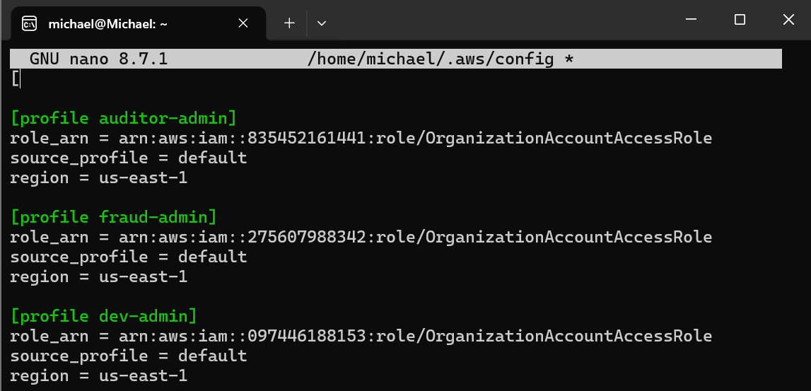

# Debugging journey

The build worked in the end, but not first time everywhere. These are the real snags, in order, and what each one taught me.

---

## 1 · I erased my own `[default]` profile

**What happened:** this project runs across four accounts, so I needed named CLI profiles. An earlier project had left two stale profiles in `~/.aws/config` that clashed with the names I wanted. I opened the file in `nano` to delete them by hand and removed too much. The `[default]` section header was gone, leaving a lone `[` on the first line.



**Symptom:** every CLI call failed, including plain `aws sts get-caller-identity`. The config file no longer parsed, and all three new profiles depend on `source_profile = default`.

**Fix:** I restored the three lines at the top of the file:

```ini
[default]
region = us-east-1
output = json
```

My access keys were never at risk. They live in `~/.aws/credentials`, which I hadn't touched.

**What I changed so it can't happen again:** config edits are now scripted, never done by hand, and always backed up first:

```bash
cp ~/.aws/config ~/.aws/config.bak
python3 - <<'PY'
import configparser, os
p = os.path.expanduser("~/.aws/config")
c = configparser.RawConfigParser(); c.read(p)
for s in ("profile sandbox-admin", "profile auditor"):
    print(("removed " if c.remove_section(s) else "not present ") + s)
with open(p, "w") as f: c.write(f)
PY
aws sts get-caller-identity --query Arn --output text   # default must still work
```

`configparser` removes only the named sections, so `[default]` can't be caught by accident. The backup gives an instant undo, and the last line proves the default identity still works before going further.

**Lesson:** when a file controls access to everything, edit it with a tool that understands its structure, and verify immediately afterwards.

---

## 2 · The terminal "hung" at `>`

**What happened:** I pasted a nested `for` loop and the prompt changed to `>` and sat there.

**What it actually was:** bash's continuation prompt. The paste had dropped the final `done`, so bash was waiting for the rest of the loop. Nothing was running.

**Fix:** `Ctrl+C` to abandon the incomplete command (safe, since nothing had executed), then paste the whole block again.

**Lesson:** `>` means "I need more input", not "I'm stuck". It's the first thing to check when a multi-line paste seems to do nothing.

---

## 3 · Access Analyzer didn't show the external-ID condition

**What I expected:** the vendor role's finding to show the `sts:ExternalId` condition.

**What I got:** `"Condition": {}` for all four findings in my query output.

**What I did:** I didn't claim otherwise. The finding tells me the door exists and who it's open to. [Trap A](trap-drills.md#trap-a-assume-the-vendor-role-without-the-external-id) is the evidence that the external ID is enforced: no ID and a wrong ID were both refused.

**Lesson:** use each tool for what it demonstrably shows. A detective control and a negative test answer different questions.

---

## 4 · Access Analyzer found a door I'd forgotten

Not a bug, but the most useful surprise of the build. Besides my three intended findings, the analyzer flagged `ubuntu-retail-github-actions-terraform`, a GitHub OIDC deploy role from `aws-terraform-iac-pipeline`. It was still assumable from outside the account. After I archived the intended findings, it was the only one left `ACTIVE`. Full write-up: [`access-analyzer.md`](access-analyzer.md#the-one-i-didnt-plant).

---

## 5 · The clean check wasn't empty

**What happened:** after teardown, my check for leftover roles

```bash
aws iam list-roles --query "Roles[?starts_with(RoleName,'nkosi-') || starts_with(RoleName,'app-')].RoleName" --output text
```

returned one name: **`nkosi-flowlogs-role`** ([`25`](screenshots/25-step11-teardown-clean-check.png)).

**What it was:** not something this build created. It's a VPC Flow Logs delivery role from an earlier project that shared the `nkosi-` prefix and was never cleaned up. Every resource from *this* build was gone: no `nkosi-` buckets, no active resource shares, and the auditor role deleted from the audit firm's account.

**Lesson:** prefix-based clean checks catch more than the current project. That's a feature. A leftover role with a trust policy is exactly the kind of forgotten access this project is about, so it goes on the clean-up list too.
